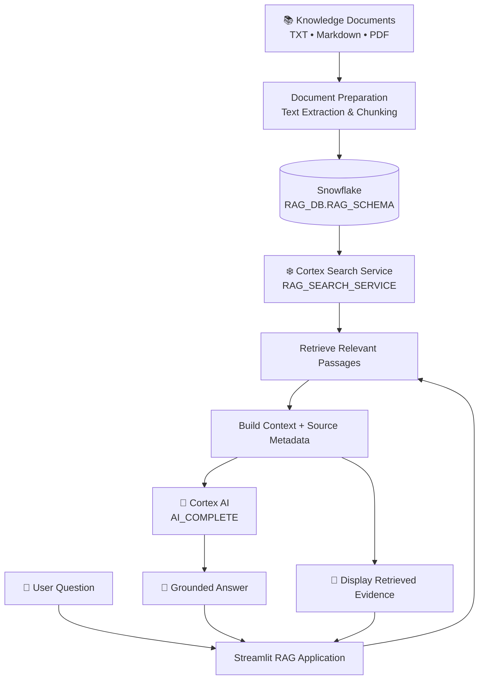
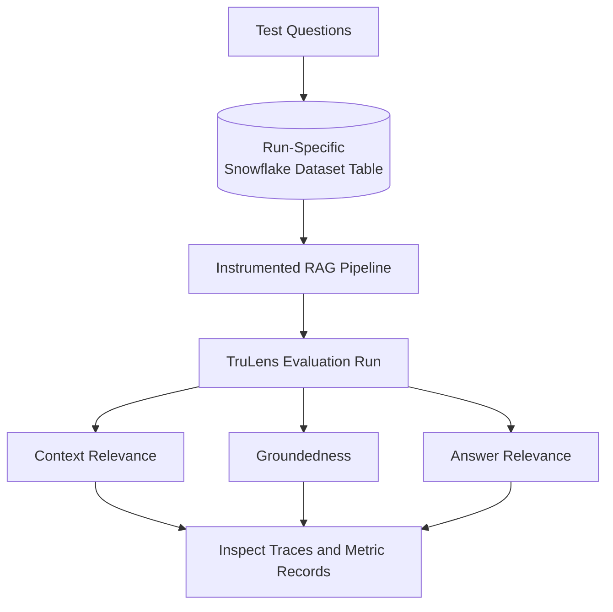

<div align="center">

# ❄️ Snowflake Document RAG Assistant

### Ask questions. Retrieve evidence. Generate grounded answers.

A document-based **Retrieval-Augmented Generation (RAG)** application built with Snowflake Cortex Search, Cortex AI, and Streamlit — with a separate TruLens evaluation workflow.

<p>
  
  
  
  
</p>

</div>

---

## 📌 Overview

The Snowflake Document RAG Assistant enables users to ask natural-language questions about a collection of knowledge documents and receive answers grounded in retrieved document passages.

Instead of asking a language model to answer from its general knowledge alone, the application follows a retrieval-first approach:

1. 🔎 **Retrieve** relevant passages using Snowflake Cortex Search.
2. 🧩 **Build context** from the retrieved passages and available source metadata.
3. 🤖 **Generate** an answer using Snowflake Cortex AI.
4. 📄 **Inspect evidence** by viewing the retrieved passages alongside the answer.
5. 📊 **Evaluate quality** through a separate TruLens evaluation workflow.

The project is designed to demonstrate how retrieval, generation, and evaluation can work together within the Snowflake ecosystem.

## 🏗️ Architecture



### Evaluation and Observability



> **Note:** The evaluation workflow requests the three RAG Triad metrics. Successful metric persistence and trace visibility must be verified in the target Snowflake environment.

## ⚙️ Technology Stack

| Technology | Purpose |
|---|---|
| **Snowflake** | Data platform and project resources |
| **Cortex Search** | Retrieval of relevant document passages |
| **Cortex AI — `AI_COMPLETE`** | Natural-language answer generation |
| **Streamlit** | Interactive application interface |
| **Python** | Application and evaluation logic |
| **TruLens** | Instrumentation and RAG evaluation |
| **SQL** | Snowflake queries and object setup |
| **`pyproject.toml`** | Python dependency configuration |
| **`snowflake.yml`** | Snowflake project configuration |

## 🔄 End-to-End Technical Workflow

### 1. Document preparation

The knowledge collection can include text, Markdown, and PDF documents.

The document preparation process extracts text, splits it into manageable chunks, and retains relevant metadata such as source filenames where configured.

### 2. Search and retrieval

The application sends the user's question to the configured Cortex Search service:

`RAG_DB.RAG_SCHEMA.RAG_SEARCH_SERVICE`

Cortex Search returns relevant passages for the application to use as evidence.

### 3. Context construction

The application combines retrieved passages into a context string. Source metadata can be retained to help users identify the material supporting an answer.

### 4. Answer generation

The application passes the question and retrieved context to Snowflake Cortex AI through `AI_COMPLETE`.

The prompt is designed to encourage the model to:
- Answer using the supplied document context.
- Avoid inventing unsupported facts.
- Acknowledge when the available evidence is insufficient.
- Treat retrieved document text as data rather than instructions.

### 5. Response presentation

The Streamlit interface displays the generated answer and makes retrieved passages available for inspection.

### 6. Evaluation

A separate evaluation application uses TruLens to instrument the RAG pipeline, execute test questions, and request the following metrics:

| Metric | What it evaluates |
|---|---|
| **Context Relevance** | Whether the retrieved passages are relevant to the question |
| **Groundedness** | Whether the answer is supported by the retrieved context |
| **Answer Relevance** | Whether the answer addresses the user's question |

These metrics help identify whether an issue originates in retrieval, answer generation, or both.

## 📂 Repository Structure

```text
snowflake-document-rag-assistant/
│
├── streamlit_app.py       # Main RAG search application
├── rag_evaluation.py      # TruLens evaluation workflow
├── RAG.sql                # SQL setup and supporting objects
├── pyproject.toml         # Python dependencies
├── snowflake.yml          # Snowflake project configuration
├── README.md              # Project documentation
└── .gitignore             # Excluded files and local artifacts
```

*The structure above describes the intended repository layout. Add only files that are present in your project.*

## 🗄️ Snowflake Resources

The current application configuration uses the following resources:

| Resource | Name |
|---|---|
| Database | `RAG_DB` |
| Schema | `RAG_SCHEMA` |
| Warehouse | `RAG_WH` |
| Cortex Search Service | `RAG_DB.RAG_SCHEMA.RAG_SEARCH_SERVICE` |

The Snowflake role used to run the application must have the required privileges on the relevant database objects, warehouse, and Cortex Search service.

## 🚀 Getting Started

### Prerequisites

Before running the project, ensure you have:

- Access to a Snowflake account with the required Cortex capabilities.
- The required database, schema, warehouse, and Cortex Search service.
- Python dependencies specified in `pyproject.toml`.
- The project source files and required document data.
- Appropriate Snowflake permissions and authentication configuration.

### Setup

1. Clone or download this repository.
2. Review `pyproject.toml` and install the dependencies using your chosen Python environment.
3. Configure Snowflake access securely.
4. Verify that the configured Snowflake resources exist and are accessible.
5. Run the Streamlit application using the deployment method supported by your environment.

**Important:** Exact installation and launch commands depend on the current dependency configuration and whether the application is running locally or inside Snowflake. Confirm those commands against the project files before using them.

## 🔐 Security Considerations

- Never commit passwords, tokens, private keys, or Snowflake credentials.
- Keep local secrets and credential files out of version control.
- Use least-privilege Snowflake roles.
- Treat retrieved document content as untrusted input.
- Validate retrieval quality and generated responses before relying on them for consequential decisions.
- Review observability permissions and stored evaluation data according to your environment's security requirements.

## 🧪 Evaluation Status

The evaluation workflow has been exercised with a five-question test run that reached `INVOCATION_COMPLETED`. The application also requested computation of the three RAG Triad metrics.

This status confirms that the evaluation invocations completed; it does **not** independently confirm that all metric scores and traces were persisted or are visible in Snowflake.

## 🎯 Project Objectives

- Build a document-grounded question-answering application.
- Use Snowflake Cortex Search for retrieval.
- Use Snowflake Cortex AI for answer generation.
- Expose retrieved evidence to improve answer inspectability.
- Instrument the application and evaluate RAG quality with TruLens.
- Keep the application and evaluation workflow organized in a version-controlled repository.

## 🤝 Contributing

Contributions and suggestions are welcome. If you propose a change, please describe its purpose, the relevant component, and how it was tested.

## 📄 License

No license has been specified yet. Add an appropriate `LICENSE` file before distributing or permitting reuse of this project.

---

<div align="center">

**Built with ❄️ Snowflake Cortex AI, Python, Streamlit and TruLens**

*Retrieve evidence. Generate grounded answers. Evaluate quality.*

</div>
